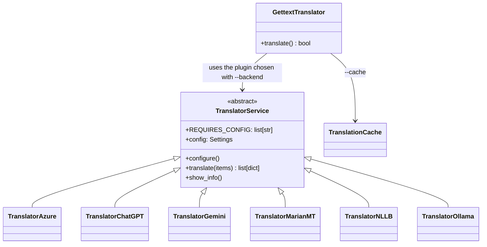

# gettext-translator

[](https://www.gnu.org/licenses/gpl-3.0.html)
[](https://github.com/rgglez/gettext-translator/actions/workflows/ci.yml)
[](https://pypi.org/project/gettext-translator/)


This program uses several cloud and local AI models to translate [gettext](https://www.gnu.org/software/gettext/) [PO](https://www.gnu.org/software/gettext/manual/html_node/PO-Files.html) files.

## Features

* Supports several backends, both local HuggingFace models, self-hosted Ollama, and remote API services.
* Extensible. You can write your own translation plugins.
* Translates only the missing entries, of one or many PO files, or whole directories.
* Each unique string is translated once, even if it appears in many files.
* Supports `msgctxt` for better contextual translation, and plural forms (`msgid_plural`).
* Validates the translations: those that lose or change placeholders (`%s`, `%(name)s`, `{name}`) or HTML tags are discarded, so `msgfmt --check` keeps passing.
* Optional cache of translations between runs.
* Dry-run mode, and output to another file or directory.
* Supports tagging of AI-generated translations.
* Supports automatic detection of language.

## Backends

See the `README.md` file in each plugin's directory for examples and information about the backends. Currently this system works with the following backends:

- **Azure AI Translator** ([README](translators/gettext-translator-azure/README.md)): remote API, commercial, API key required.
- **OpenAI ChatGPT** ([README](translators/gettext-translator-chatgpt/README.md)): remote API, several models, commercial, API key required.
- **Google Gemini** ([README](translators/gettext-translator-gemini/README.md)): remote API, several models, commercial with a free layer, API key required.
- **MarianMT** ([README](translators/gettext-translator-marianmt/README.md)): local HuggingFace *Helsinki-NLP* model, free, auth token might be required.
- **NLLB** ([README](translators/gettext-translator-nllb/README.md)): local HuggingFace *NLLB* model, free, auth token might be required.
- **Ollama** ([README](translators/gettext-translator-ollama/README.md)): self-hosted (by yourself) Ollama server running free models.

## Installation

Python 3.12 or newer is required. Install the program with the backends you want to use:

```bash
pip install "gettext-translator[ollama]"
pip install "gettext-translator[chatgpt,gemini]"
pip install "gettext-translator[all]"
```

### From source code

Install the plugin interface, the program and the backends you need, from the root of the repository:

```bash
pip install -e translators/gettext-translator-service -e . -e translators/gettext-translator-ollama
```

## General CLI arguments

The command line tool supports the following arguments:

- ```--info```: Shows information about the backend.
- ```--backend```: Which backend to use.
- ```--po```: One or more .po files or directories. Directories are searched recursively for .po files.
- ```--src```: The source language. Default: en.
- ```--dst```: The language to translate to. Files whose `Language` header is a different language are skipped.
- ```--fuzzy```: Remove the fuzzy flag from all the entries before translating.
- ```--context```: Optional default translation context for msgid without msgctxt.
- ```--ascribe```: Add an `AI-translated` comment to each translated entry. Existing comments are kept.
- ```--config```: Path to the YAML configuration file for the backend. Default: config.yaml.
- ```--dry-run```: Show the translations without saving any file.
- ```--output```: Save to this .po file (single input file) or directory (keeping the relative paths), instead of overwriting the input files.
- ```--cache```: Path to a SQLite file where the translations are cached, so they are not requested again in later runs. The cache is specific to the backend, model and languages.
- ```--verbose```: Show useful information. Possible values: debug, info, warning, error, critical. Default: warning.
- ```--version```: Shows the version.
- ```--help```: Shows the help message.

The exit code is 1 if there was an error, or if there were strings to translate but none could be translated.

### Per backend configuration

To avoid cluttering of the command line arguments, each backend has its own configuration file, in YAML format. This file contains the backend's-specific options, as described in each plugin's `README.md` file. Please refer to those files (linked above), or use the `--info` argument to display the `README.md` and list the required options for each backend (view usage example below).

Values with the form `"env:VARIABLE"` are read from the environment variable `VARIABLE`, which is useful for API keys.

You must specify the path to the configuration file using the `--config` argument.

A sample configuration file for each backend is provided in each plugin's directory, under `translators/gettext-translator-<backend>/<backend>-sample.yaml`.

## Usage examples

View the README file for the plugin and which options are required for it:

```bash
gettext-translator --info --backend chatgpt
```

Translate using the Azure AI Translator backend:

```bash
gettext-translator --backend azure --src es --dst de_DE --config translators/gettext-translator-azure/azure-sample.yaml --po example/messages.po
```

Translate using the ChatGPT backend, adding a comment attributing translations to AI:

```bash
gettext-translator --backend chatgpt --src es --dst de_DE --config translators/gettext-translator-chatgpt/chatgpt-sample.yaml --po example/messages.po --ascribe
```

Preview the translation of all the German .po files of a project with Ollama, caching the results, and then save them (the second run uses the cache and doesn't call the model again):

```bash
gettext-translator --backend ollama --src en --dst de --config ollama.yaml --po locale/ --cache translations.db --dry-run
gettext-translator --backend ollama --src en --dst de --config ollama.yaml --po locale/ --cache translations.db
```

## Plural forms

The number of plural forms is read from the `Plural-Forms` header of each file (2 if it is missing). LLM backends (ChatGPT, Gemini, Ollama) translate every plural form. The machine translation backends (Azure, MarianMT, NLLB) translate the singular and the plural `msgid` separately, which is right for languages with two plural forms; for languages with more forms (Russian, Polish, Arabic...) use an LLM backend.

## Architecture

This software was designed with extensibility as a priority, so it's not restricted to a single service or provider. It is based on an auto-discovery plugin system, and users can create additional plugins as needed. See [gettext-translator-service](translators/gettext-translator-service/README.md) to write your own.



## Development

```bash
make dev     # editable install of the packages and the dev tools
make check   # lint, tests, build and twine check
```

Releases are published to PyPI by the `Publish` GitHub workflow when a `vX.Y.Z` tag is pushed (`make release`). Only the packages whose version changed are uploaded. Run `make help` for the other targets.

## Notes

* It is recommended that you learn about [gettext](https://www.gnu.org/software/gettext/) and the [format of PO files](https://www.gnu.org/software/gettext/manual/html_node/PO-Files.html). But of course, if you are reading this, you should already know it.
* Why gettext?
  * It uses full strings in the source language as keys. This is the most relevant reason, as it means you don't have to search for abstract keys like `page.title.hello` or `item.specification`. While that approach may work for a few strings, it becomes complicated and chaotic with hundreds or thousands of them.
  * The original key string is used as a fallback. If a translation doesn't exist, the original string is displayed.
  * It's a tried and trusted GNU standard.
* For the example PO file, the best contextual results were obtained using Azure's AI Translator service and the ```qwen3:14b``` model in Ollama.

## License

Copyright (C) 2026 Rodolfo González González.

Licensed under [GPL 3.0](https://www.gnu.org/licenses/gpl-3.0.html).